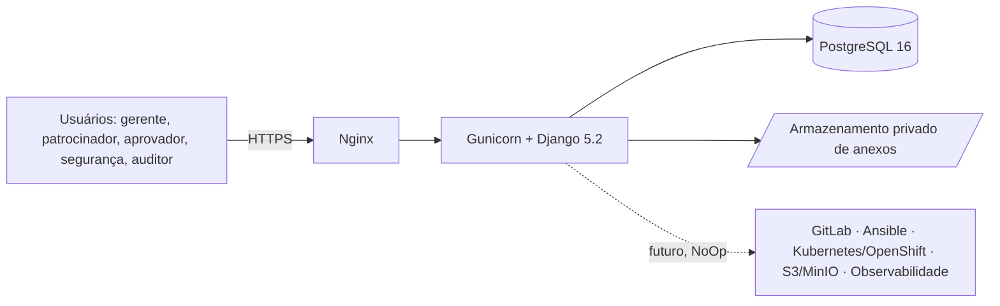
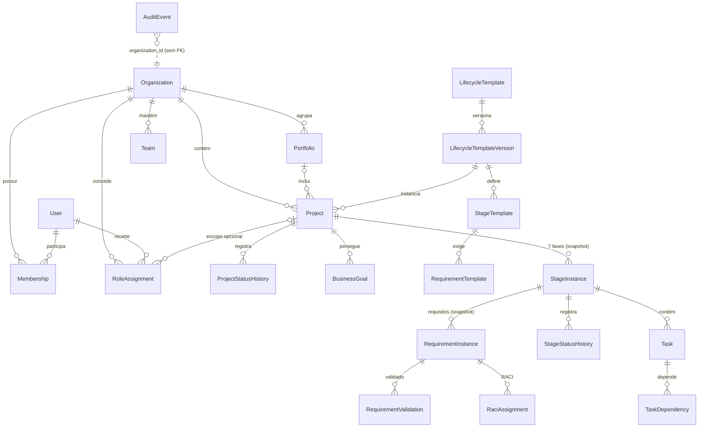
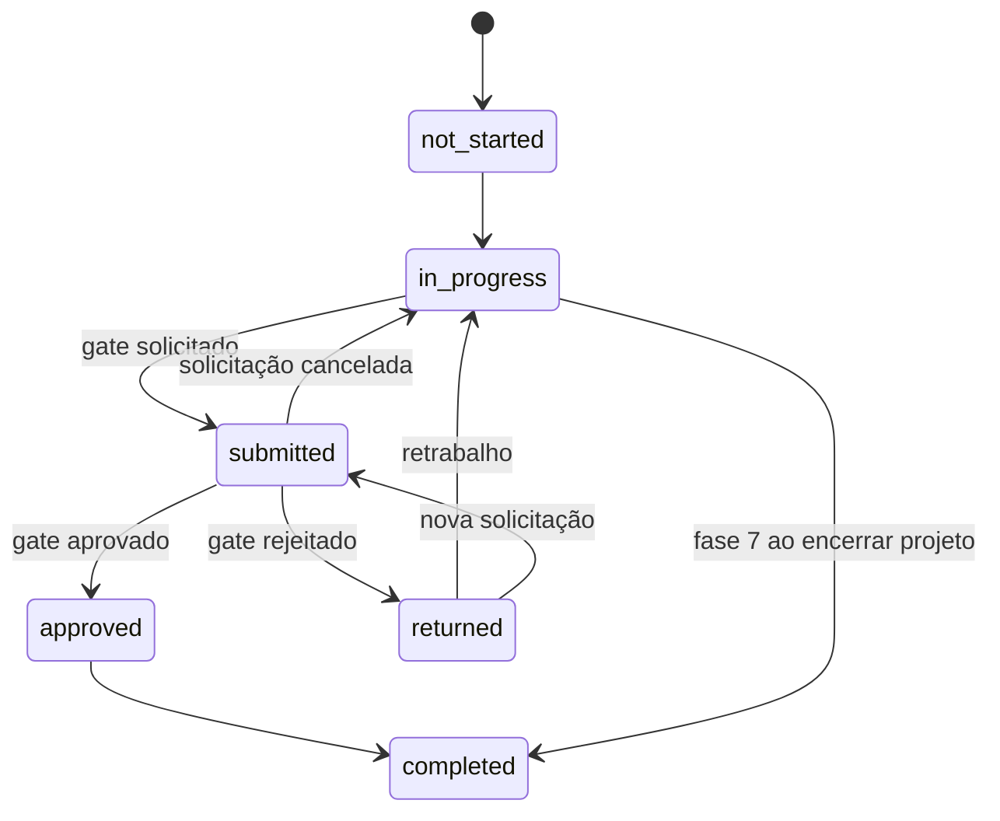

# Visão geral da arquitetura

## Contexto

## Módulos (monólito modular)

| Módulo | Responsabilidade |
|---|---|
| core | mixins de modelo, correlação de requisições, healthz, carregamento com escopo (anti-IDOR), seed |
| accounts | usuário, autenticação, limitação de tentativas, senha |
| organizations | organizações, vínculos, papéis com escopo, matriz RBAC |
| auditlog | trilha append-only e serviço `record`; `atomic_service` |
| projects | portfólios, projetos, objetivos, histórico de status |
| lifecycle | templates versionados, fases, requisitos, validações, tarefas, equipes, RACI |

Regras críticas residem em `services.py` de cada módulo; views/APIs apenas validam entrada e chamam serviços.

## Modelo de dados (M1–M2)

## Máquina de estados da fase

